# Kanji Map

Personal Nuxt 4 + Nuxt UI app that maps **WaniKani** and **BunPro** mastery onto a pannable grid of **常用漢字 (jōyō) + community JLPT kanji**.

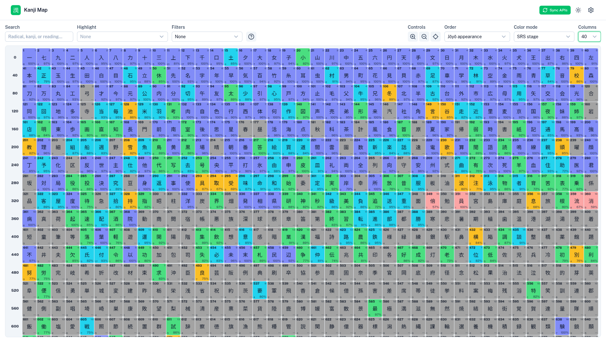

## Purpose

Japanese literacy is taught against a national character list (**常用漢字**), with elementary years fixed by MEXT’s **学年別漢字配当表** (小1–小6). SRS apps like WaniKani teach a related but different sequence and omit some curriculum characters entirely.

**Kanji Map** answers: *where am I on the school / jōyō list, relative to my SRS progress?*

- Visualize every tracked character in one scrollable map
- Color by **school year**, **JLPT level**, **SRS stage**, **review accuracy**, **WaniKani level**, **stroke count**, or **reading count** (or turn coloring off)
- Spot **untracked** kanji (on the map but not in WaniKani) vs **unstudied** WK kanji (no positive SRS yet)
- Reorder the same corpus by literacy structure, JLPT level, lesson order, SRS, accuracy, frequency, readings, or strokes
- **Highlight** by school year, JLPT level, SRS band, and/or WK level (OR within a category, AND across)
- Click any cell for meanings, readings (including **nanori** from [kanjiapi.dev](https://kanjiapi.dev/)), mnemonics, stroke order, and example words
- Cookie-backed **Settings** for kanji font (Gothic / Mincho / Calligraphic) and default order / color mode

There is **no user auth in v1** — API keys live in `.env` for a personal / self-hosted install. The UI defaults to **light mode** (toggle in the header).

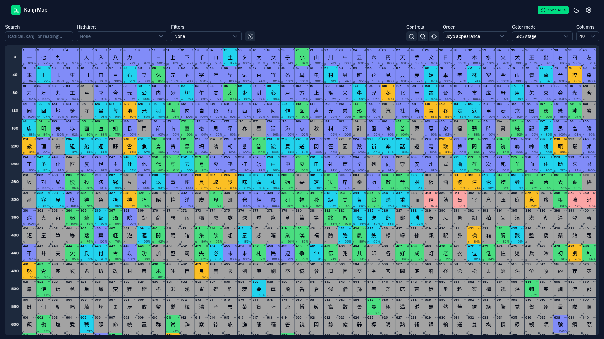

## Toolbar layout

Controls are split left / right:

| Side | Controls |
|------|----------|
| **Left** | **Search** · **Highlight** · **Filters** · **Help** (?) |
| **Right** | **Controls** (zoom / fit) · **Order** · **Color mode** · **Columns** |

Header (always): **Sync APIs** · theme toggle · **Settings** (gear).

## Ordering modes

**Order** only changes cell sequence. Colors and filters stay the same. Screenshots below use light mode, **SRS stage** coloring, and 40 columns unless noted.

### Jōyō appearance (default)

Curriculum-first layout: **常用漢字** by elementary school year (小1→小6), then remaining jōyō (中学+) by stroke count, then non-jōyō JLPT extras.


### JLPT level

Unofficial community JLPT tags: **N5 → N4 → N3 → N2 → N1**, then characters with no JLPT tag (unranked). Ties break with jōyō appearance.

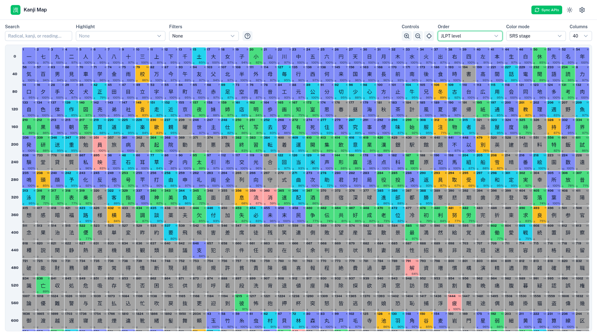

### WaniKani order

Lesson order from WaniKani’s kanji catalog: **WK level → API appearance order**. Characters **not** in WaniKani sort at the end (untracked).


### SRS stage

Highest averaged SRS first; unstudied / untracked last. Requires a WaniKani API key.

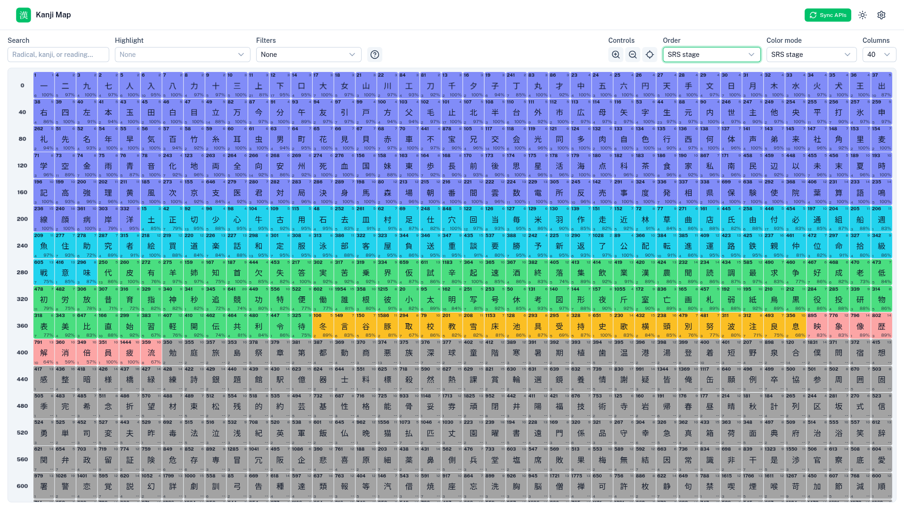

### Usage (frequency)

Newspaper / corpus **frequency rank** (lower rank = more common first).


### Accuracy

Highest review accuracy first. Requires a WaniKani API key.

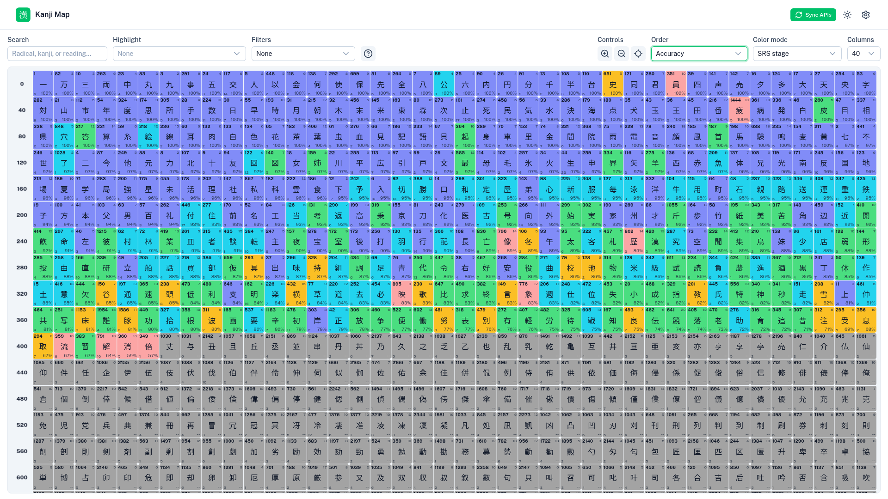

### Number of readings

Most distinct on/kun reading stems first (okurigana variants collapsed; nanori excluded; missing data counts as 0), then the same jōyō appearance tie-break as above.

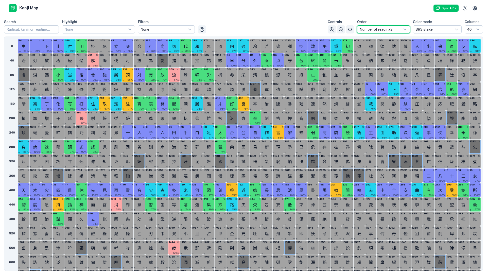

### Stroke count

Fewest strokes first (unknown stroke counts last), then jōyō appearance.

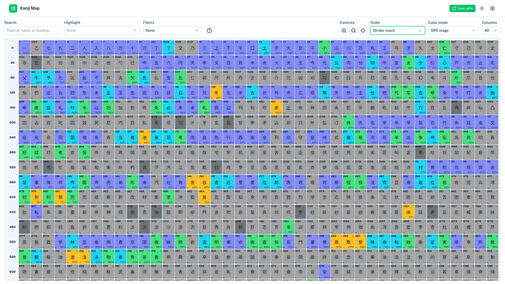

## Color modes

**Color mode** paints each cell. Default **--** uses uniform grey. Progress modes (SRS, accuracy, WaniKani level) require a configured WaniKani API key. In SRS/accuracy modes: blue outline = **untracked**; lighter grey without outline = **unstudied**.

Screenshots below use **Jōyō appearance** order and 40 columns.

### -- (none, default)

Every cell uses the same neutral grey. Corner labels and highlights still work.

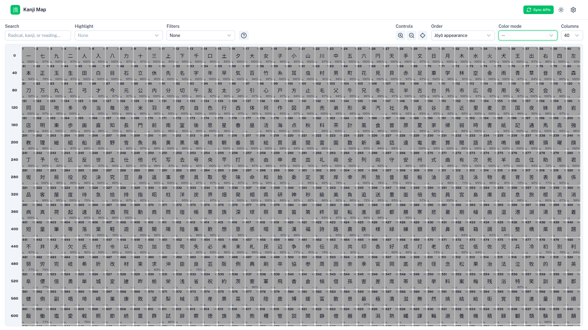

### School year

| Band | Color |
|------|--------|
| 小1–小6 | Red → orange → amber → green → cyan → blue |
| 中学+ (jōyō) | Indigo |
| Non-jōyō extras | Grey |

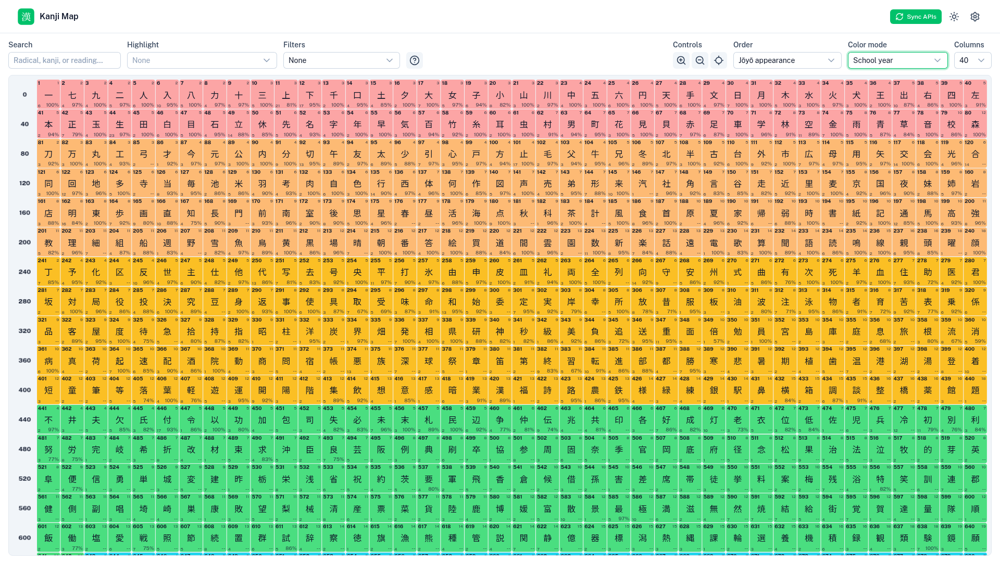

### JLPT level

Unofficial community JLPT tags (N5 easiest → N1 hardest). Characters without a JLPT tag stay grey.

| Band | Color |
|------|--------|
| N5–N1 | Red → orange → amber → green → indigo |
| No JLPT tag | Grey |

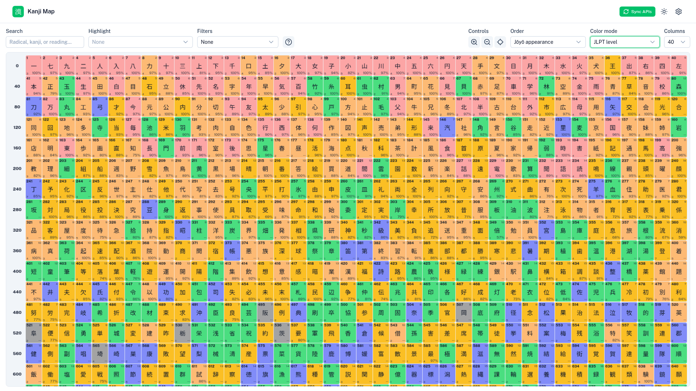

### SRS stage

Bands follow the WaniKani-style stage scale (BunPro stages normalized to 0–9): apprentice → guru → master → enlightened → burned.

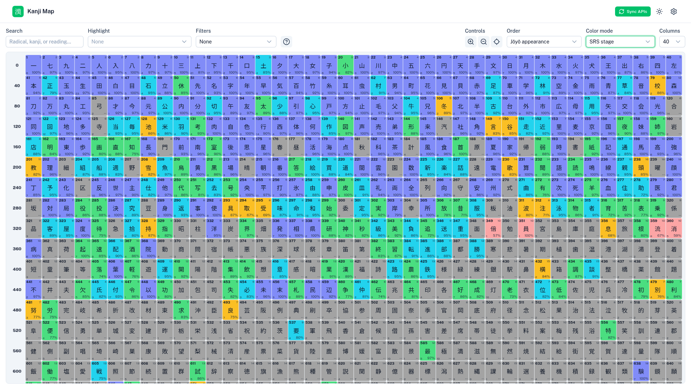

### Accuracy heatmap

Cell color is **review accuracy %** (0–100) in **3% steps**, with RGB interpolation between anchors:

| Range | Colors |
|-------|--------|
| **100% → 50%** | Green → lime → yellow → **red** |
| **50% → 0%** | **Red** → magenta (~25%) → **purple** (~0%) |


### WaniKani level

Same green→purple scale as accuracy. Level **1** → green; level **60** → purple (`pct = (1 − level / 60) × 100`). Catalog-missing kanji stay grey (blue outline when untracked).

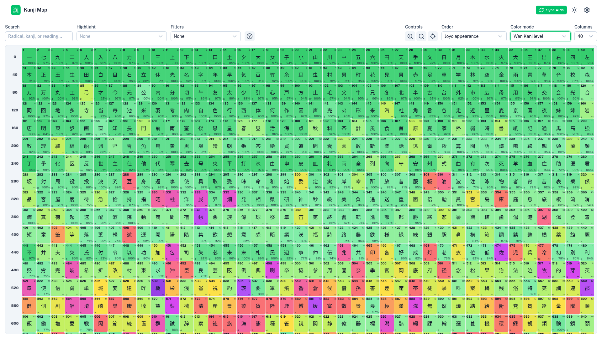

### Stroke count / reading count heatmaps

Same green→purple scale. For each cell:

`pct = (1 − count / max) × 100`

where `max` is the corpus-wide maximum. Highest counts → purple; lowest → green. Missing stroke data stays grey.

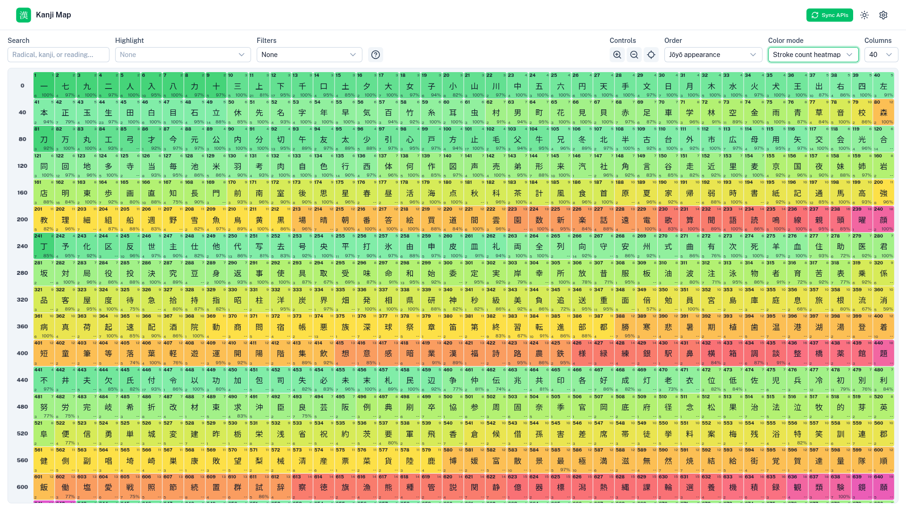

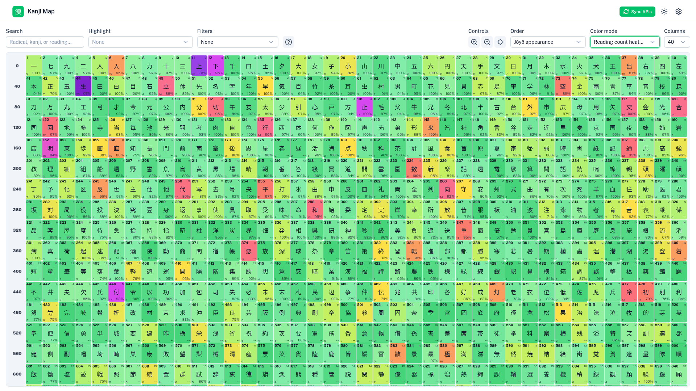

## Highlight

**Highlight** is a multi-select with **collapsible** categories:

1. **School year** (小1–小6, 中学+)
2. **JLPT level** (N5–N1)
3. **SRS stage** (when WaniKani is configured)
4. **WaniKani level** 1–60 (when configured; starts collapsed)

Match rule: **OR within a category**, **AND across categories**. Non-matches are dimmed. Use the in-menu search box to filter long lists (e.g. WK levels).

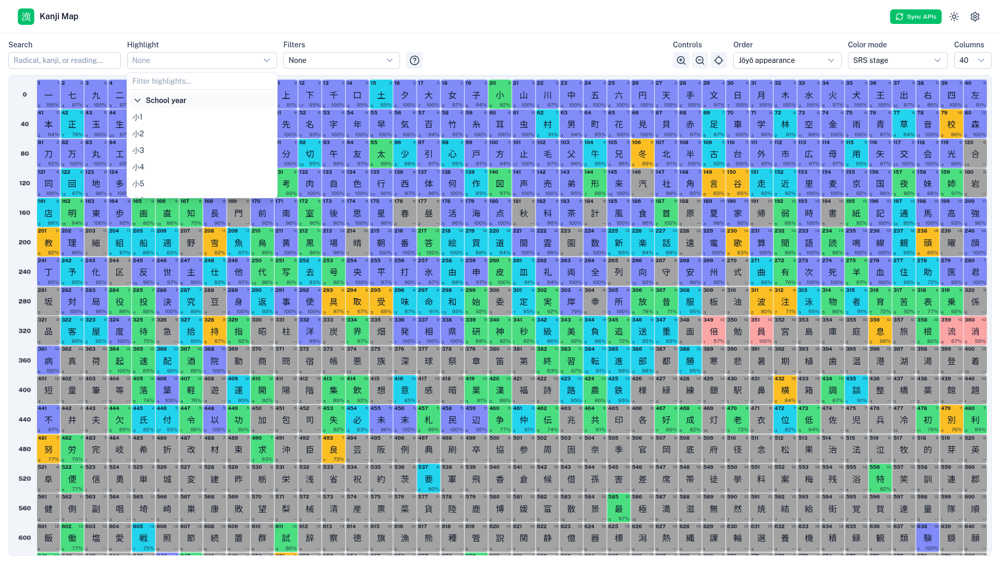

**Search** (separate field) also dims non-matches for radical / component / kana reading queries.

**Filters** is a multi-select. Each chosen filter **removes** matching cells: Untracked, Unstudied, Unhighlighted, or Burned (SRS stage 9). Turning several on hides every matching group.

## Kanji detail modal

Click a cell to open meanings, readings, mnemonics, review stats, animated **stroke order** ([KanjiVG](https://kanjivg.tagaini.net/), CC BY-SA 3.0), and example words. WaniKani data is preferred when available; **nanori (name readings)** come from [kanjiapi.dev](https://kanjiapi.dev/) / Kanjidic (WK nanori lists are inconsistent). Jisho meanings / BunPro examples fill other gaps. Kanji glyphs follow the Settings font at **regular weight**.

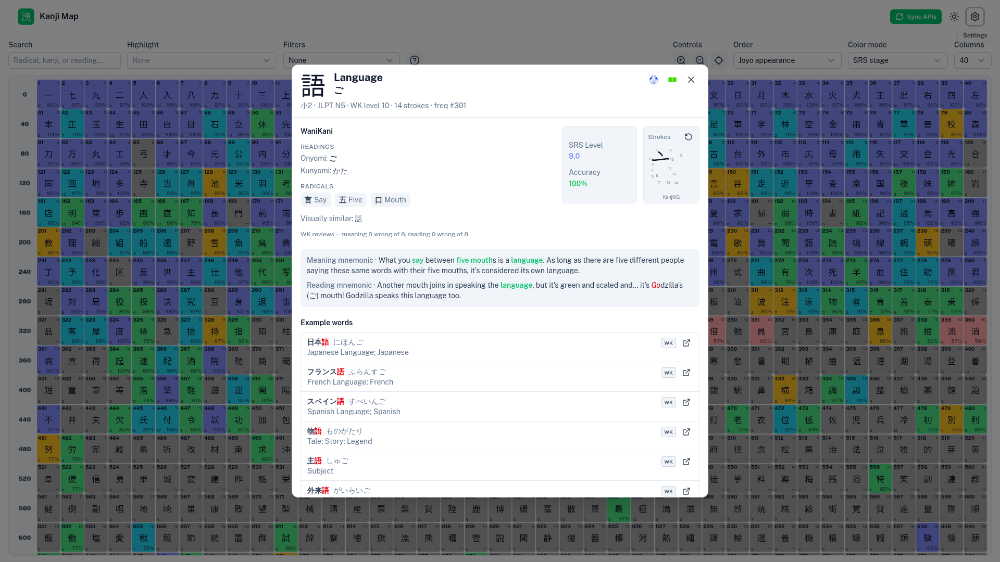

## Help modal

The **?** button (next to Filters) explains cell corner labels, color legends, school-year bands, and unstudied vs untracked.

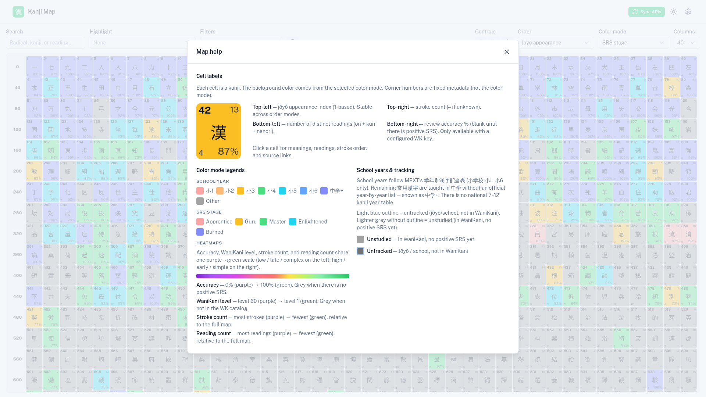

## Settings

Header **gear** opens Settings (cookie on this device):

| Setting | Options |
|---------|---------|
| **Kanji font** | Gothic (default), Mincho, Calligraphic |
| **Default order** | Same options as the Order control |
| **Default color mode** | Same options as Color mode (WK-gated modes hidden without a key) |

A live **字** preview updates as you change the font. Cancel discards; Save writes the cookie.

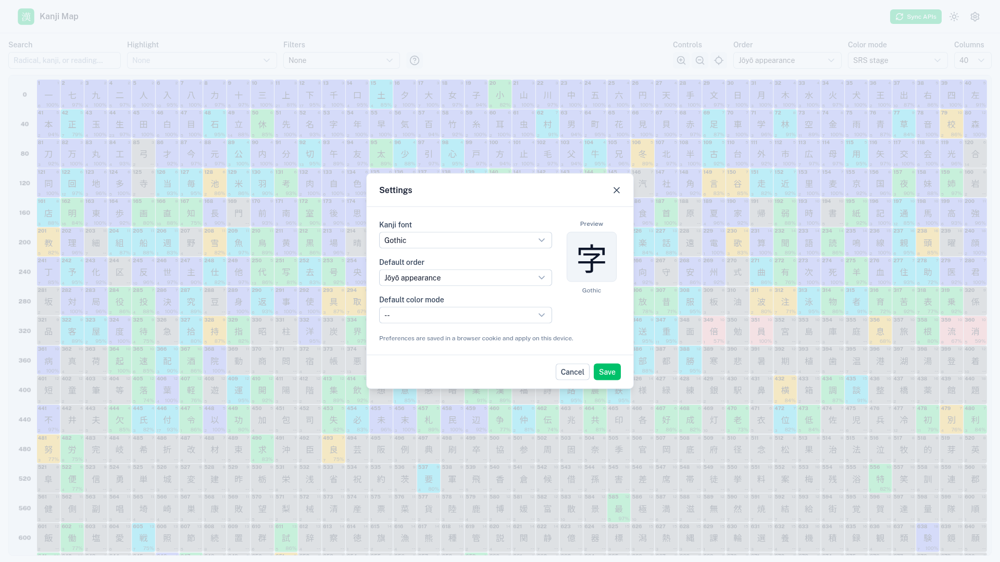

## Map controls (quick reference)

| Control | Behavior |
|---------|----------|
| **Search** | Radical, kanji, or kana reading — dims non-matches |
| **Highlight** | Multi-select year / JLPT / SRS / WK level; collapsible groups |
| **Filters** | Toggle Untracked, Unstudied, Unhighlighted, and Burned; matching cells are removed |
| **Help** | Cell legend + color / tracking explainer |
| **Controls** | Zoom in / out, fit map to view |
| **Order** | Jōyō, JLPT, WaniKani, SRS, usage, accuracy, readings, strokes |
| **Color mode** | --, school year, JLPT, SRS, accuracy, WK level, strokes, readings |
| **Columns** | 10–70 (includes 10/15/20 for mobile); default 40. Extra gutter column shows row indices (0, n, 2n, …) |
| **Theme** | Light by default; header toggle for dark |
| **Settings** | Font + default order / color mode (cookie) |
| **Pan** | Drag the map, or **↑ / ↓** |
| **Zoom** | Mouse wheel, toolbar buttons, or **Numpad + / −** |

- Light blue outline = **untracked** (on the map, not in WaniKani)
- Lighter grey, no outline = **unstudied** (in WaniKani, no positive SRS yet)
- Accuracy corner shows blank when WaniKani is not configured; `--` when unstudied

Merge rule: when both APIs have data for a character, **average** SRS (BunPro normalized to WK 0–9) and accuracy.

## Prerequisites

- **Node.js** ≥ 24
- **pnpm** 10.x (see `packageManager` in `package.json`)

```bash
node -v
corepack enable
corepack prepare pnpm@10.34.4 --activate
```

## Local setup

### 1. Clone and install

```bash
git clone <your-fork-or-remote-url> kanji-map
cd kanji-map
pnpm install
```

### 2. Create `.env`

Copy the sample file and fill in your keys. **Never commit `.env`.**

```bash
cp sample.env .env
```

| Variable | Required? | Purpose |
|----------|-----------|---------|
| `WANIKANI_API_KEY` | Recommended | Official WaniKani API token |
| `BUNPRO_FRONTEND_JWT` | Optional | BunPro `frontend_api_token` **cookie** value |
| `DATABASE_PATH` | Optional | SQLite path (default `./data/kanji-map.sqlite`) |

You can sync with only WaniKani, only BunPro, or both. Empty keys are skipped with a warning.

#### WaniKani API key

1. Log in at [wanikani.com](https://www.wanikani.com)
2. **Account Settings** → **API Tokens** → create/copy a token
3. Paste into `.env` as `WANIKANI_API_KEY=` (raw token only)

#### BunPro frontend token

Use the **`frontend_api_token` cookie** from a logged-in browser session — **not** the Account Settings “API key” (deprecated for `/api/frontend`).

The cookie is often a **32-character hex** string (not always a JWT). Env name `BUNPRO_FRONTEND_JWT` is kept for compatibility; paste the **cookie value only** (no `Token token=` or `Bearer` prefix).

1. Log in at [bunpro.jp](https://bunpro.jp)
2. DevTools → **Application** → **Cookies** → `https://bunpro.jp`
3. Copy **`frontend_api_token`**
4. Set `BUNPRO_FRONTEND_JWT=<cookie value>` in `.env`
5. Restart the dev server after changing `.env`

Tokens expire periodically; refresh the cookie when sync returns 401.

The app sends `Authorization: Token token=…` (Bearer fallback). Some unofficial BunPro routes can still 500 even with a valid token — failing routes are skipped. See the [community OpenAPI](https://github.com/cbullard-dev/bunpro-community-api).

### 3. Seed the database

```bash
pnpm db:seed
```

Schema updates are also applied automatically when the app starts (`ensureSchema`). After pulling large schema changes you can also run:

```bash
pnpm db:push
```

### 4. Run the app

```bash
pnpm dev
```

Open [http://localhost:3000](http://localhost:3000).

Click **Sync APIs** in the header to pull WaniKani / BunPro progress into SQLite. Re-sync is safe (idempotent upserts).

## After pulling updates

```bash
git pull
pnpm install
pnpm db:seed   # if kanji data or seed script changed
pnpm dev
```

Restart `pnpm dev` whenever you change `.env`.

## Scripts

| Script | Description |
|--------|-------------|
| `pnpm dev` | Dev server → http://localhost:3000 |
| `pnpm build` / `pnpm preview` | Production build / preview |
| `pnpm lint` / `pnpm test` / `pnpm typecheck` | Quality gates |
| `pnpm db:seed` | Seed `kanji_ref` from `data/kanji-union.json` (+ Jisho radical/parts + Kanjidic readings) |
| `pnpm data:jisho-meta` | Fetch/update Jisho kanji radical + parts metadata (rate-limited; writes `data/kanji-jisho-meta.json`) |
| `pnpm data:kanjiapi-nanori` | Fetch nanori (name readings) from [kanjiapi.dev](https://kanjiapi.dev/) (writes `data/kanji-nanori.json`) |
| `pnpm db:push` | Push Drizzle schema to SQLite |
| `pnpm db:generate` | Generate migrations from `drizzle/schema.ts` |
| `pnpm data:build` | Rebuild `data/kanji-union.json` from `data/raw/` |
| `pnpm screenshots` | Refresh `docs/screenshots/` (requires `pnpm dev` running; uses system Chrome via puppeteer-core) |

## Docker

```bash
# Local compose (mounts source; set env in compose / .env)
docker compose up --build

# Cloud Run–oriented image
docker build -f build/Dockerfile -t kanji-map:local .
```

### Cloud Run + SQLite caveat

The production image can run on Cloud Run, but the default SQLite path under `/tmp` is **ephemeral**. For a real deploy, mount persistent storage (GCS FUSE / volume) or replicate with Litestream. Local file persistence is the supported v1 model.

## Wrong-answer logging (future)

WaniKani and BunPro do **not** expose the text of incorrect answers. Typed-answer analysis will need a future **Chrome / Firefox extension**. See [`.ai/memory-bank/plans/wrong-answer-extension.md`](.ai/memory-bank/plans/wrong-answer-extension.md).

## Data attribution

See [`NOTICE.md`](NOTICE.md).

## AI / agent docs

Start at [`.ai/AI-SETUP-GUIDE.md`](.ai/AI-SETUP-GUIDE.md).
