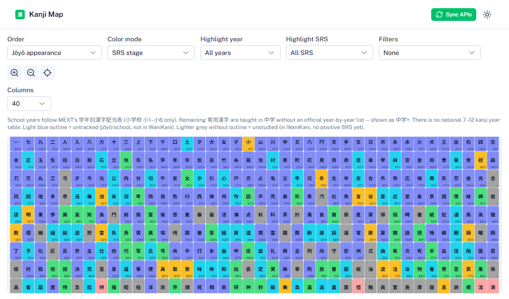
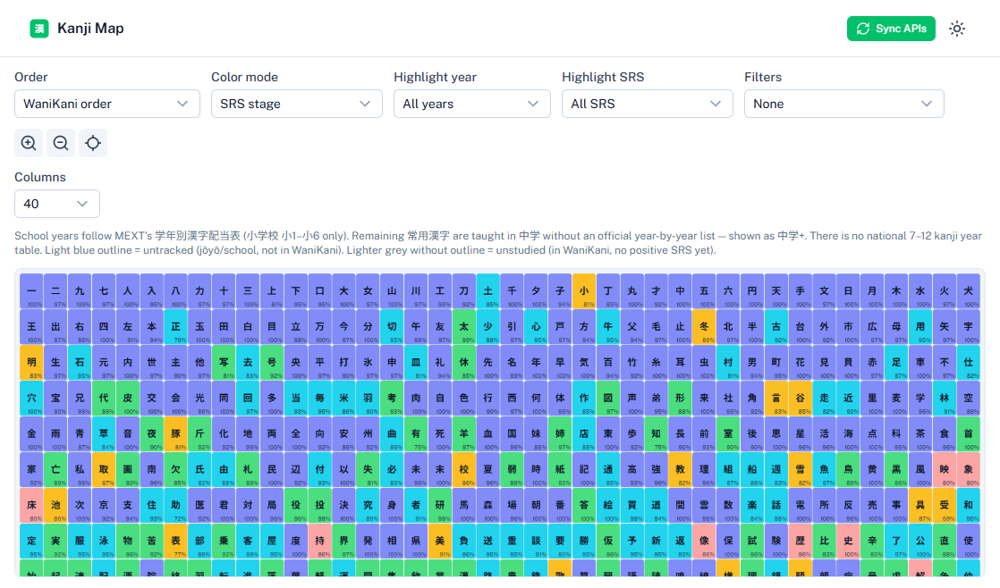
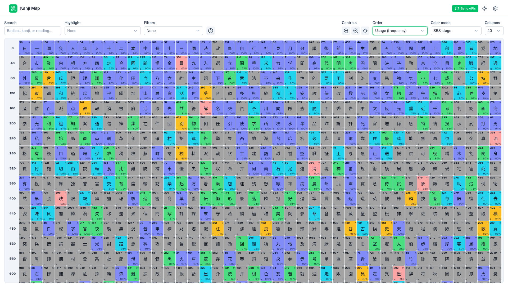
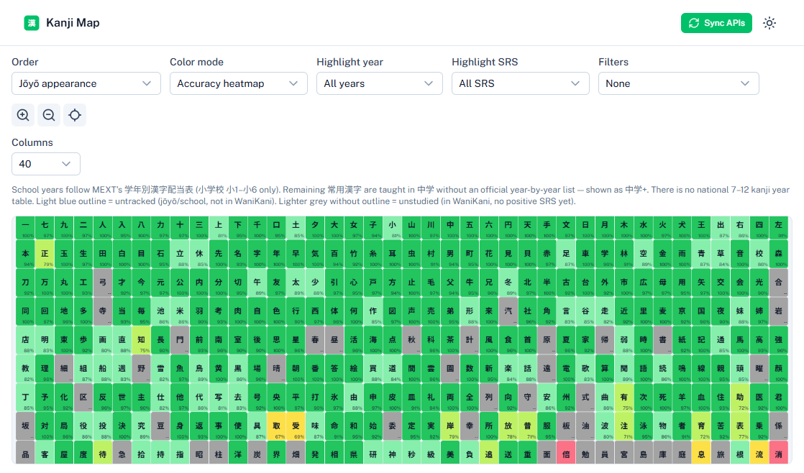
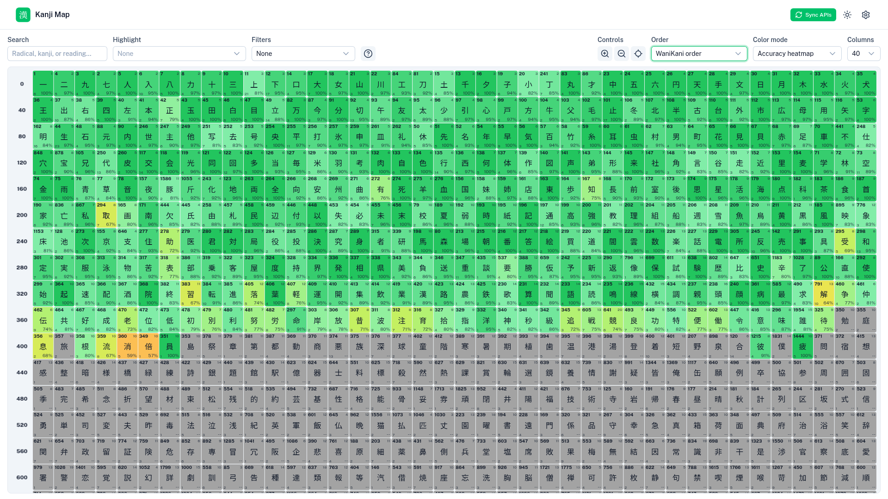

# Kanji Map

Personal Nuxt 4 + Nuxt UI app that maps **WaniKani** and **BunPro** mastery onto a pannable grid of **常用漢字 (jōyō) + community JLPT kanji**.



## Purpose

Japanese literacy is taught against a national character list (**常用漢字**), with elementary years fixed by MEXT’s **学年別漢字配当表** (小1–小6). SRS apps like WaniKani teach a related but different sequence and omit some curriculum characters entirely.

**Kanji Map** answers: *where am I on the school / jōyō list, relative to my SRS progress?*

- Visualize every tracked character in one scrollable map
- Color by **SRS stage** or **review accuracy** (WaniKani + BunPro merged)
- Spot **untracked** curriculum kanji (not in WaniKani) vs **unstudied** WK kanji (no positive SRS yet)
- Reorder the same corpus by literacy structure, lesson order, or real-world frequency
- Click any cell for meanings, readings, mnemonics, and example words (WaniKani when available; Jisho / BunPro examples as fallbacks), plus a link to Jisho
- Animated **stroke order** diagrams in the detail modal ([KanjiVG](https://kanjivg.tagaini.net/), CC BY-SA 3.0)

There is **no user auth in v1** — API keys live in `.env` for a personal / self-hosted install. The UI defaults to **light mode** (toggle in the header).

## Ordering modes

The **Order** control only changes cell sequence on the grid. Colors and filters stay the same. Screenshots below are light mode, SRS coloring, 40 columns.

### Jōyō appearance (default)

Curriculum-first layout: **常用漢字** ordered by elementary school year (小1→小6), then remaining jōyō (中学+) by stroke count, then non-jōyō JLPT extras. Use this when you care about school / literacy coverage.


### WaniKani order

Lesson order from WaniKani’s kanji catalog: **WK level → API appearance order**. Characters on the jōyō/school list that are **not** in WaniKani sort at the end (untracked). Use this to follow your SRS queue spatially.



### Usage (frequency)

Newspaper / corpus **frequency rank** (lower rank = more common first). Use this to prioritize high-utility characters independent of school year or WK level.



## Color modes

**Color mode** paints each studied cell from merged WaniKani / BunPro progress. Untracked and unstudied cells stay grey (blue outline = untracked).

### SRS stage (default)

Bands follow the WaniKani-style stage scale (BunPro stages normalized to 0–9): apprentice → guru → master → enlightened → burned.

### Accuracy heatmap

Cell color is **review accuracy %** (0–100), not SRS stage. Colors advance in **3% steps**, with RGB interpolation between these anchors:

| Range | Colors |
|-------|--------|
| **100% → 50%** | Green → lime → yellow → **red** |
| **50% → 0%** | **Red** → magenta (~25%) → **purple** (~0%) |

Grey cells still mean unstudied / untracked (no accuracy to plot). The percentage in the cell corner is the same value driving the color.





## Prerequisites

- **Node.js** ≥ 24
- **pnpm** 10.x (see `packageManager` in `package.json`)

```bash
node -v
corepack enable
corepack prepare pnpm@10.34.4 --activate
```

## Local setup

### 1. Clone and install

```bash
git clone <your-fork-or-remote-url> kanji-map
cd kanji-map
pnpm install
```

### 2. Create `.env`

Copy the sample file and fill in your keys. **Never commit `.env`.**

```bash
cp sample.env .env
```

Edit `.env`:

| Variable | Required? | Purpose |
|----------|-----------|---------|
| `WANIKANI_API_KEY` | Recommended | Official WaniKani API token |
| `BUNPRO_FRONTEND_JWT` | Optional | BunPro `frontend_api_token` **cookie** value |
| `DATABASE_PATH` | Optional | SQLite path (default `./data/kanji-map.sqlite`) |

You can sync with only WaniKani, only BunPro, or both. Empty keys are skipped with a warning.

#### WaniKani API key

1. Log in at [wanikani.com](https://www.wanikani.com)
2. **Account Settings** → **API Tokens** → create/copy a token
3. Paste into `.env` as `WANIKANI_API_KEY=` (raw token only)

#### BunPro frontend token

Use the **`frontend_api_token` cookie** from a logged-in browser session — **not** the Account Settings “API key” (deprecated for `/api/frontend`).

The cookie is often a **32-character hex** string (not always a JWT). Env name `BUNPRO_FRONTEND_JWT` is kept for compatibility; paste the **cookie value only** (no `Token token=` or `Bearer` prefix).

1. Log in at [bunpro.jp](https://bunpro.jp)
2. DevTools → **Application** → **Cookies** → `https://bunpro.jp`
3. Copy **`frontend_api_token`**
4. Set `BUNPRO_FRONTEND_JWT=<cookie value>` in `.env`
5. Restart the dev server after changing `.env`

Tokens expire periodically; refresh the cookie when sync returns 401.

The app sends `Authorization: Token token=…` (Bearer fallback). Some unofficial BunPro routes can still 500 even with a valid token — failing routes are skipped. See the [community OpenAPI](https://github.com/cbullard-dev/bunpro-community-api).

### 3. Seed the database

Loads the committed kanji union (`data/kanji-union.json`) into SQLite and creates tables if needed:

```bash
pnpm db:seed
```

Schema updates are also applied automatically when the app starts (`ensureSchema`). After pulling large schema changes you can also run:

```bash
pnpm db:push
```

### 4. Run the app

```bash
pnpm dev
```

Open [http://localhost:3000](http://localhost:3000).

Click **Sync APIs** in the header to pull WaniKani / BunPro progress into SQLite. Re-sync is safe (idempotent upserts).

## After pulling updates

```bash
git pull
pnpm install
pnpm db:seed   # if kanji data or seed script changed
pnpm dev
```

Restart `pnpm dev` whenever you change `.env`.

## Map controls

| Control | Behavior |
|---------|----------|
| **Order** | Jōyō appearance (default), WaniKani order, or usage frequency — see [Ordering modes](#ordering-modes) |
| **Color mode** | SRS stage (default) or accuracy heatmap — see [Color modes](#color-modes) |
| **Highlight year / SRS** | Dim cells that do not match (visual only) |
| **Search** | Enter a radical or kanji to highlight matches and kanji that use that component (Jisho parts/radical data) |
| **Filters** | **Remove** untracked, unstudied, or unhighlighted cells from the grid |
| **Columns** | 25–70 (step 5); default 40. Grid renders n+1 tracks: a transparent row-index gutter (0, n, 2n, …) plus n kanji columns |
| **Theme** | Light by default; header toggle for dark |
| **Pan** | Drag the map, or **↑ / ↓** anywhere on the page |
| **Zoom** | Mouse wheel, toolbar buttons, or **Numpad + / −** |

- Light blue outline = **untracked** (jōyō/school, not in WaniKani)
- Lighter grey, no outline = **unstudied** (in WaniKani, no positive SRS yet)
- Accuracy shows `--` when unstudied

Merge rule: when both APIs have data for a character, **average** SRS (BunPro normalized to WK 0–9) and accuracy.

## Scripts

| Script | Description |
|--------|-------------|
| `pnpm dev` | Dev server → http://localhost:3000 |
| `pnpm build` / `pnpm preview` | Production build / preview |
| `pnpm lint` / `pnpm test` / `pnpm typecheck` | Quality gates |
| `pnpm db:seed` | Seed `kanji_ref` from `data/kanji-union.json` (+ Jisho radical/parts from `data/kanji-jisho-meta.json`) |
| `pnpm data:jisho-meta` | Fetch/update Jisho kanji radical + parts metadata (rate-limited; writes `data/kanji-jisho-meta.json`) |
| `pnpm db:push` | Push Drizzle schema to SQLite |
| `pnpm db:generate` | Generate migrations from `drizzle/schema.ts` |
| `pnpm data:build` | Rebuild `data/kanji-union.json` from `data/raw/` |

## Docker

```bash
# Local compose (mounts source; set env in compose / .env)
docker compose up --build

# Cloud Run–oriented image
docker build -f build/Dockerfile -t kanji-map:local .
```

### Cloud Run + SQLite caveat

The production image can run on Cloud Run, but the default SQLite path under `/tmp` is **ephemeral**. For a real deploy, mount persistent storage (GCS FUSE / volume) or replicate with Litestream. Local file persistence is the supported v1 model.

## Wrong-answer logging (future)

WaniKani and BunPro do **not** expose the text of incorrect answers. Typed-answer analysis will need a future **Chrome / Firefox extension**. See [`.ai/memory-bank/plans/wrong-answer-extension.md`](.ai/memory-bank/plans/wrong-answer-extension.md).

## Data attribution

See [`NOTICE.md`](NOTICE.md).

## AI / agent docs

Start at [`.ai/AI-SETUP-GUIDE.md`](.ai/AI-SETUP-GUIDE.md).
